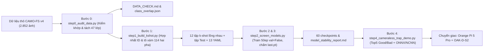
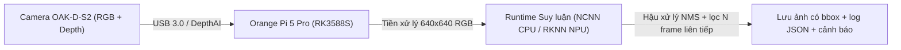

# BÁO CÁO KỸ THUẬT & HƯỚNG DẪN CHUYỂN GIAO DỰ ÁN
## Nhận diện Sinh vật Ngụy trang Ít mẫu (Few-Shot Camouflaged Animal Detection) bằng YOLO trên bộ dữ liệu CAMO-FS

**Bối cảnh đồ án:** Trạm Bẫy Ảnh Sinh Thái Thông Minh (*Smart Edge Camera Trap*) kết hợp **Orange Pi 5 Pro (`OPI-01`)** + **Camera Luxonis OAK-D-S2 (`OAK-01`)**.  
**Trạng thái hiện tại:** Hoàn thành toàn diện Giai đoạn Dữ liệu, Huấn luyện & Đánh giá Khoa học (Bước 0 → Bước 3: 60/60 mô hình trên GPU RTX 5060); sẵn sàng chạy Bước 4 (phân tích định tính & xuất mô hình nhúng) để chuyển giao sang đội tích hợp phần cứng biên.

---

## TÓM TẮT ĐIỀU HÀNH (EXECUTIVE SUMMARY)

1. **Chuẩn hóa dữ liệu không rò rỉ (Zero Data Leakage):** Đã kiểm toán toàn bộ **2.852 ảnh vật lý** của bản phát hành `CAMO-FS` (`danhnt/camo-fs-dataset` v4, `split1`): **197 ảnh Support (235 instances)** + **2.655 ảnh Test (3.108 instances)**, đối khớp 100% file trên đĩa (`0` ảnh giao nhau giữa Support và Test). Đã phát hiện và khắc phục triệt để 2 lỗi ngầm trong nhãn gốc: trùng `annotation_id` giữa các file lớp (`826`, `386`, `387`) và nguy cơ cắt lẹm bbox giao nhau trên **38 ảnh đa vật thể** bằng thuật toán tô xám 2 pha (`pixel = 114`).
2. **Tuân thủ quy chuẩn Few-Shot nghiêm ngặt:** Đã sinh 12 tập lồng nhau ($1\text{-shot} \subset 2\text{-shot} \subset 3\text{-shot} \subset 5\text{-shot}$) qua 3 seeds (`0, 1, 2`), cố định `epochs=50`, tắt `val=False` trong khi train để tuyệt đối không chạm tập Test, và chỉ đánh giá trên `weights/last.pt`.
3. **Vượt mốc chuẩn bài báo gốc FS-CDIS (*IEEE Access* 2024):**
   - Trong bài báo gốc của tác giả Thanh-Danh Nguyen et al., **FS-CDIS (IMS, ResNet-101, ~60M tham số)** đạt **4.50 / 6.95 / 7.55 / 10.36 Box AP** tương ứng với `1 / 2 / 3 / 5`-shot.
   - Trên cùng tập Test `split1`, mô hình **`yolo11s_spatial_attn` (9.45M tham số)** đạt đỉnh tuyệt đối **6.72 / 9.51 / 11.77 / 14.34 Box AP**, còn **`v8s_rich_backbone` (11.15M tham số)** đạt **6.00 / 8.50 / 10.46 / 13.56 Box AP** với độ ổn định cao nhất ở 5-shot (`Std = ±0.12`).
   - Đặc biệt, ngay cả khi loại bỏ toàn bộ 8 lớp trùng trực tiếp COCO và 7 lớp cùng họ ngữ nghĩa, chỉ tính riêng trên **32 lớp mới hoàn toàn (`Strictly Novel`)** ở mốc `5-shot` (`seed=0`), **`v8s_rich_backbone` đạt 10.40 Box AP** và **`yolo11s_spatial_attn` đạt 11.54 Box AP** — tự thân vượt qua mốc toàn cục `10.36 AP` của FS-CDIS.
4. **Quyết định chọn mô hình bàn giao:** Khuyến nghị **`v8s_rich_backbone`** (`yolov8s.pt`, `freeze=10`, `mosaic=0.0`, `lr0=0.0005`) làm **mô hình triển khai chính** trên Orange Pi 5 Pro (với **`v8n_nomosaic_stable`** làm phương án siêu nhẹ dự phòng cho VPU của OAK-D-S2) nhờ kiến trúc Pure CNN dễ giải thích, phương sai thấp nhất và tương thích phần cứng biên 100%.

---

## PHẦN I. MÔI TRƯỜNG THỰC NGHIỆM & KIẾN TRÚC PIPELINE TỔNG THỂ

### 1.1. Môi trường phần cứng và phần mềm đã kiểm chứng
| Thành phần | Thông số ghi nhận thực tế |
| :--- | :--- |
| **GPU Huấn luyện & Đánh giá** | NVIDIA GeForce RTX 5060 Laptop GPU (8151 MiB VRAM) |
| **Phiên bản Python / DL Stack** | Python `3.13.15`, PyTorch `2.14.1+cu130`, Ultralytics `8.4.210` |
| **Gói suy luận / xuất biên hiện có** | `onnxruntime` (đã cài); `onnx`, `onnxslim`, `ncnn`, `depthai`, `blobconverter` (chưa cài trên máy train) |
| **Phần cứng mục tiêu bàn giao** | Orange Pi 5 Pro (`OPI-01`, SoC RK3588S / NPU) + Camera Luxonis OAK-D-S2 (`OAK-01`, Myriad X VPU) |

### 1.2. Luồng xử lý dữ liệu và mô hình từ đầu đến cuối



---

## PHẦN II. KIỂM TOÁN DỮ LIỆU (BƯỚC 0) & PIPELINE FEW-SHOT (BƯỚC 1)

### 2.1. Kiểm toán bộ dữ liệu CAMO-FS (`code/step0_audit_data.py`)
Kết quả đối chiếu tại `results/DATA_CHECK.md` và `results/class_overlap.json`:

- **Giải mã chênh lệch 6 ảnh so với bài báo gốc (`2.852` vs `2.858`):** Trong bản phát hành Kaggle `danhnt/camo-fs-dataset` (version 4), thư mục ảnh chứa đúng **2.852 file vật lý** (`camouflage_00000000.jpg` đến `camouflage_00002852.jpg`, khuyết chỉ số `00001601`). Trong đó:
  - Tập Support (`subsplit/split1`): **197 ảnh duy nhất** / **235 instances** (47 lớp × 5 instances).
  - Tập Test (`camo5_test_split1.json`): **2.655 ảnh duy nhất** / **3.108 instances** (`0` ảnh không nhãn).
  - **Không rò rỉ dữ liệu:** $197 + 2.655 = 2.852$, `on_disk_not_in_json = []`, `in_json_not_on_disk = []`, không có ảnh giao giữa Support và Test.
- **Phân tầng 47 lớp so với 80 lớp tiền huấn luyện MS-COCO:**
  Để tránh hiện tượng mô hình hưởng lợi sẵn từ trọng số COCO rồi bị ngộ nhận là học tốt từ vài mẫu (few-shot illusion), `step0_audit_data.py` phân 47 lớp thành 3 tầng:
  1. **Trùng tên trực tiếp (`exact`, 8 lớp):** `Bird` (10), `Bear` (16), `Cat` (18), `Dog` (20), `Elephant` (21), `Giraffe` (23), `Horse` (26), `Mouse` (31).
  2. **Cùng họ ngữ nghĩa (`semantic_family`, 7 lớp):** `Deer` (19), `Fox` (22), `Goat` (24), `Leopard` (28), `Lion` (29), `Sea_Lion` (35), `Tiger` (38).
  3. **Mới hoàn toàn (`novel`, 32 lớp):** `Frog`, `Crab`, `Dolphin`, `Fish`, `Octopus`, `Seahorse`, `Shrimp`, `Starfish`, `Scorpion`, `Spider`, `Penguin`, `Snail`, `Insect`, `Moth`, `Bat`, `Camel`, `Hedgehog`, `Kangaroo`, `Monkey`, `Pig`, `Rabbit`, `Rhino`, `Sloth`, `Squirrel`, `Weasel`, `Body_Painting`, `Solider`, `Crocodile`, `Lizard`, `Snake`, `Turtle`, `Worm`.

> **Lưu ý minh bạch về cách tính cột `Pure Novel AP` trong `step2_screen_models.py`:**  
> Hàm `load_overlap_ids()` trong `code/step2_screen_models.py` đọc trường `exact_or_token_overlap_yolo_ids` (**8 lớp exact**), và đánh dấu `nv_mask = ~ov_mask`. Do đó, cột `Pure Novel AP` trong file `results/model_stability_report.md` là điểm trung bình của **39 lớp không trùng tên trực tiếp** (32 lớp `novel` + 7 lớp `semantic_family`). Để phản ánh trung thực tuyệt đối, Mục 4.3 bên dưới báo cáo bổ sung kết quả bóc tách riêng cả **32 lớp Strictly Novel** lẫn **7 lớp Semantic Family**.

### 2.2. Pipeline tạo tập $k$-shot lồng nhau & Tô xám an toàn (`code/step1_build_kshot.py`)
1. **Khắc phục lỗi trùng `annotation_id` trong JSON gốc:** Hàm `merge_official_subsplits()` hợp nhất 47 file `*_5shot_split1.json` thành `results/camo5_support_5shot_merged.json` và đánh lại ID duy nhất `1..235`, cứu lại 3 instances bị ghi đè nếu gộp thô (`ann_id=826` trùng giữa `Fish` và `Moth`; `ann_id=386, 387` trùng giữa `Lizard` và `Snake`).
2. **Bảo toàn tính chất lồng nhau ($1\text{-shot} \subset 2\text{-shot} \subset 3\text{-shot} \subset 5\text{-shot}$):**
   - `seed=0`: Sắp xếp theo `official_rank` (`1, 2, 3, 5`) khớp 100% với phân chia subsplit chính thức của tác giả FS-CDIS.
   - `seed=1, 2`: Xáo trộn danh sách 5 instances/lớp bằng `random.Random(seed * 10007 + cid)` rồi cắt `[:k]` theo thứ tự `k = 1, 2, 3, 5` kèm `assert prev_selected_ids.issubset(selected_ann_ids)`.
3. **Thuật toán tô xám 2 pha (`mask_unselected_instances_safe`, `fill_value=114`):**
   Trong 197 ảnh Support có **38 ảnh chứa nhiều hơn 1 instance** (kể cả trường hợp box chồng lấp nhau 100% như mẹ–con ở lớp `Camel`). Nếu giữ nguyên các vật thể không được chọn mà không gán nhãn, YOLO sẽ coi chúng là nền (âm tính giả); nếu tô xám đơn thuần 1 pha, box không chọn nằm chồng sẽ xóa mất pixel của vật thể được chọn.
   - **Pha 1:** Tô xám `RGB=(114, 114, 114)` lên toàn bộ vùng `unselected_bboxes`.
   - **Pha 2:** Đắp lại nguyên vẹn vùng pixel gốc của `selected_bboxes`.
   - **Kiểm chứng Unit Test:** Chạy `python code/test_week1_pipeline.py` xác nhận 3/3 ca kiểm thử CPU (tô xám chồng lấn, bước 0 kiểm toán, bước 1 sinh tập lồng nhau) đạt `PASS 100%`.

| Phân chia (`runs/processed_data/`) | `seed=0` (Ảnh / Instances) | `seed=1` (Ảnh / Instances) | `seed=2` (Ảnh / Instances) | Ghi chú cấu hình `.yaml` |
| :--- | :---: | :---: | :---: | :--- |
| `k1_seed{0,1,2}` | 47 / 47 | 47 / 47 | 47 / 47 | `val:` trỏ vào chính `k1_seed*` |
| `k2_seed{0,1,2}` | 94 / 94 | 92 / 94 | 90 / 94 | Số ảnh < 94 khi 2 lớp chọn chung ảnh |
| `k3_seed{0,1,2}` | 141 / 141 | 132 / 141 | 127 / 141 | Tập trung nhiều instance từ 38 ảnh kép |
| `k5_seed{0,1,2}` | 197 / 235 | 197 / 235 | 197 / 235 | Đủ 235 instances (5 × 47 lớp) |
| `test` | 2.655 / 3.108 | 2.655 / 3.108 | 2.655 / 3.108 | Độc lập tuyệt đối, không chạm khi train |

---

## PHẦN III. THIẾT KẾ THỰC NGHIỆM & CẤU HÌNH CÁC BIẾN THỂ MÔ HÌNH (BƯỚC 2 & 3)

### 3.1. Quy chuẩn chống rò rỉ và đảm bảo tính lặp lại
Trong `code/step2_screen_models.py`, toàn bộ **60 lượt huấn luyện** (`5 biến thể × 4 mốc k-shot × 3 seeds`) tuân thủ chung một giao thức:
- **Siêu tham số cố định:** `epochs=50`, `batch=8`, `imgsz=640`, `optimizer="AdamW"`, `weight_decay=0.0005`, `momentum=0.937`, `warmup_epochs=3.0`, `deterministic=True`, `amp=True`, `cache="ram"`.
- **Không nhìn tập Test khi train:** Đặt `val=False` (file YAML trỏ `val:` vào chính tập Support; ở epoch 50, Ultralytics chạy 1 lượt đánh giá cuối lên chính tập Support để xuất biểu đồ, hoàn toàn không đọc tập Test).
- **Chấm điểm chuẩn mực:** Chỉ load `weights/last.pt` sau khi train xong đủ 50 epochs để đánh giá một lần duy nhất trên `test` (`2.655 ảnh`, `3.108 instances`).

### 3.2. Đặc tả kỹ thuật 5 biến thể mô hình khảo sát
Các số liệu về tham số, GFLOPs, dung lượng và thời gian huấn luyện dưới đây được đo trực tiếp từ các checkpoint `k5_seed0/weights/last.pt`:

| Biến thể | Trọng số gốc | Tham số tổng (47 lớp) | Tham số đóng băng (`freeze`) | Tham số huấn luyện (Neck+Head) | GFLOPs (640px) | Dung lượng `last.pt` | `lr0` | `mosaic` / `close_mosaic` | Thời gian train 50ep (k=5) |
| :--- | :---: | :---: | :---: | :---: | :---: | :---: | :---: | :---: | :---: |
| `v8n_baseline` | `yolov8n.pt` | 3.149.181 | 1.272.656 (`40.4%`, tầng `0..9`) | 1.876.525 (`59.6%`) | 8.81 | 6.51 MB | `0.001` | `1.0` / `10` | ~131.8 s |
| `v8n_nomosaic_stable` | `yolov8n.pt` | 3.149.181 | 1.272.656 (`40.4%`, tầng `0..9`) | 1.876.525 (`59.6%`) | 8.81 | 6.51 MB | `0.0005` | `0.0` / `0` | ~143.8 s |
| **`v8s_rich_backbone`** | `yolov8s.pt` | **11.153.789** | **5.079.712 (`45.5%`, tầng `0..9`)** | **6.074.077 (`54.5%`)** | **28.74** | **22.54 MB** | **`0.0005`** | **`0.0` / `0`** | **~162.1 s** |
| `yolo11n_spatial_attn` | `yolo11n.pt` | 2.616.061 | 1.365.472 (`52.2%`, tầng `0..10`) | 1.250.589 (`47.8%`) | 6.63 | 5.51 MB | `0.0005` | `0.0` / `0` | ~121.2 s |
| `yolo11s_spatial_attn` | `yolo11s.pt` | 9.445.981 | 5.441.984 (`57.6%`, tầng `0..10`) | 4.003.997 (`42.4%`) | 21.77 | 19.20 MB | `0.0005` | `0.0` / `0` | ~164.7 s |

*Ghi chú cấu trúc đóng băng:*
- Trên **YOLOv8 (`freeze=10`)**, các tầng `0..9` tương ứng trọn vẹn với **Backbone** (`Conv` + `C2f` + kết thúc ở khối `SPPF` tầng 9); toàn bộ **Neck (PAN-FPN)** và **Decoupled Anchor-Free Head** (`tầng 10..22`) được mở khóa để thích nghi với lớp ngụy trang mới.
- Trên **YOLO11 (`freeze=11`)**, các tầng `0..10` đóng băng toàn bộ **Backbone** gồm cả khối **`C2PSA` (Spatial Attention)** ở tầng 10; toàn bộ **Neck + Head** (`tầng 11..23`) được huấn luyện.

---

## PHẦN IV. KẾT QUẢ THỰC NGHIỆM & PHÂN TÍCH KHOA HỌC

### 4.1. Bảng đối chiếu trực tiếp với bài báo gốc FS-CDIS (*IEEE Access* 2024)
Độ đo: **Box AP (`mAP@50:95`, %)** trên toàn bộ 47 lớp, tính `Mean ± Std` qua 3 seeds (`0, 1, 2`):

| Phương pháp | Kiến trúc / Tham số | 1-shot | 2-shot | 3-shot | 5-shot | Độ trễ RTX 5060 |
| :--- | :---: | :---: | :---: | :---: | :---: | :---: |
| FS-CDIS (ITL, IEEE Access 2024) | Mask R-CNN ResNet-101 (~60M) | 4.04 | 7.28 | 7.49 | 9.76 | — |
| FS-CDIS (IMS, IEEE Access 2024) | Mask R-CNN ResNet-101 (~60M) | 4.50 | 6.95 | 7.55 | 10.36 | — |
| `v8n_baseline` (Ours) | YOLOv8n (3.15M, Mosaic=1.0) | 2.82 ± 0.62 | 4.59 ± 0.86 | 6.14 ± 0.77 | 8.36 ± 0.43 | 1.85 ms |
| `v8n_nomosaic_stable` (Ours) | YOLOv8n (3.15M, Mosaic=0.0) | **4.64 ± 0.56** | 5.48 ± 0.71 | 7.38 ± 0.78 | 8.92 ± 0.31 | 1.84 ms |
| `yolo11n_spatial_attn` (Ours) | YOLO11n (2.62M, C2PSA) | **4.66 ± 0.64** | 6.25 ± 0.91 | **8.40 ± 1.07** | 9.34 ± 0.28 | 1.91 ms |
| **`v8s_rich_backbone` (Ours — Đề xuất triển khai)** | **YOLOv8s (11.15M, Pure CNN)** | **6.00 ± 0.65** | **8.50 ± 0.95** | **10.46 ± 0.61** | **13.56 ± 0.12** | **4.35 ms** |
| `yolo11s_spatial_attn` (Ours — Đỉnh hiệu năng) | YOLO11s (9.45M, C2PSA) | **6.72 ± 0.45** | **9.51 ± 0.93** | **11.77 ± 1.26** | **14.34 ± 0.26** | 4.34 ms |

### 4.2. Bảng kết quả chi tiết qua các ngưỡng IoU và tách nhóm lớp (Mean ± Std, `results/model_stability_report.md`)

| Biến thể | k-shot | Box AP (All 47) | Box AP50 (All) | Box AP75 (All) | Non-Exact AP (39 lớp)* | COCO-Overlap AP (8 lớp) | Độ trễ (ms) |
| :--- | :---: | :---: | :---: | :---: | :---: | :---: | :---: |
| `v8n_baseline` | 1-shot | 2.82 ± 0.62 | 4.82 ± 0.92 | 2.80 ± 0.58 | 1.79 ± 0.15 | 7.85 ± 3.09 | 1.85 ms |
| `v8n_nomosaic_stable` | 1-shot | 4.64 ± 0.56 | 6.74 ± 0.88 | 4.89 ± 0.63 | 2.62 ± 0.29 | 14.49 ± 2.22 | 1.81 ms |
| `yolo11n_spatial_attn` | 1-shot | 4.66 ± 0.64 | 6.87 ± 0.83 | 4.98 ± 0.80 | 2.08 ± 0.31 | 17.24 ± 3.32 | 1.88 ms |
| `v8s_rich_backbone` | 1-shot | 6.00 ± 0.65 | 8.56 ± 1.08 | 6.39 ± 0.72 | 3.55 ± 0.40 | 17.93 ± 2.37 | 4.33 ms |
| `yolo11s_spatial_attn` | 1-shot | 6.72 ± 0.45 | 9.58 ± 0.68 | 6.96 ± 0.54 | 4.08 ± 0.63 | 19.58 ± 1.71 | 4.34 ms |
| `v8n_baseline` | 2-shot | 4.59 ± 0.86 | 7.77 ± 1.35 | 4.38 ± 0.88 | 3.61 ± 0.54 | 9.40 ± 2.77 | 1.87 ms |
| `v8n_nomosaic_stable` | 2-shot | 5.48 ± 0.71 | 8.67 ± 0.91 | 5.57 ± 1.04 | 3.72 ± 0.55 | 14.05 ± 2.14 | 1.86 ms |
| `yolo11n_spatial_attn` | 2-shot | 6.25 ± 0.91 | 9.21 ± 1.02 | 6.85 ± 0.92 | 4.21 ± 0.58 | 16.20 ± 3.54 | 1.94 ms |
| `v8s_rich_backbone` | 2-shot | 8.50 ± 0.95 | 12.36 ± 1.22 | 9.22 ± 0.98 | 6.26 ± 0.78 | 19.40 ± 3.45 | 4.34 ms |
| `yolo11s_spatial_attn` | 2-shot | 9.51 ± 0.93 | 14.19 ± 1.28 | 9.83 ± 1.13 | 6.50 ± 0.75 | 24.15 ± 2.74 | 4.39 ms |
| `v8n_baseline` | 3-shot | 6.14 ± 0.77 | 10.20 ± 1.13 | 5.84 ± 0.78 | 5.23 ± 0.83 | 10.57 ± 0.68 | 1.87 ms |
| `v8n_nomosaic_stable` | 3-shot | 7.38 ± 0.78 | 11.64 ± 1.21 | 7.45 ± 0.84 | 5.81 ± 0.72 | 14.98 ± 1.54 | 1.84 ms |
| `yolo11n_spatial_attn` | 3-shot | 8.40 ± 1.07 | 12.46 ± 1.44 | 8.75 ± 1.05 | 6.36 ± 1.14 | 18.37 ± 1.41 | 1.89 ms |
| `v8s_rich_backbone` | 3-shot | 10.46 ± 0.61 | 15.56 ± 0.75 | 11.29 ± 0.60 | 7.92 ± 0.78 | 22.87 ± 2.81 | 4.34 ms |
| `yolo11s_spatial_attn` | 3-shot | 11.77 ± 1.26 | 17.04 ± 1.85 | 12.27 ± 1.27 | 8.95 ± 1.20 | 25.52 ± 2.57 | 4.33 ms |
| `v8n_baseline` | 5-shot | 8.36 ± 0.43 | 13.84 ± 0.74 | 8.23 ± 0.31 | 7.68 ± 0.40 | 11.63 ± 0.89 | 1.83 ms |
| `v8n_nomosaic_stable` | 5-shot | 8.92 ± 0.31 | 13.65 ± 0.41 | 9.12 ± 0.14 | 7.58 ± 0.48 | 15.49 ± 1.15 | 1.86 ms |
| `yolo11n_spatial_attn` | 5-shot | 9.34 ± 0.28 | 14.07 ± 0.37 | 9.54 ± 0.28 | 7.68 ± 0.57 | 17.39 ± 1.96 | 1.93 ms |
| **`v8s_rich_backbone`** | **5-shot** | **13.56 ± 0.12** | **19.82 ± 0.39** | **14.34 ± 0.20** | **10.84 ± 0.33** | **26.81 ± 0.88** | **4.38 ms** |
| `yolo11s_spatial_attn` | 5-shot | 14.34 ± 0.26 | 20.79 ± 0.44 | 15.01 ± 0.17 | 11.60 ± 0.27 | 27.69 ± 0.57 | 4.31 ms |

*\*Ghi chú: Cột `Pure Novel AP` trong file CSV/Markdown tự động ứng với 39 lớp không trùng trực tiếp COCO (`~exact_or_token_overlap`).*

### 4.3. Kiểm chứng bóc tách 4 tầng lớp & Phân tích lớp dễ/khó (trên `k5_seed0`)
Kết quả đo kiểm trực tiếp trên 2.655 ảnh Test (cả 47 lớp đều có mặt trong kết quả đánh giá) đối với hai mô hình dẫn đầu tại `k5_seed0`:

| Mô hình (`k5_seed0`) | All (47 lớp) | Exact COCO (8 lớp) | Semantic Family (7 lớp) | **Strictly Novel (32 lớp)** | Non-Exact (39 lớp) |
| :--- | :---: | :---: | :---: | :---: | :---: |
| **`v8s_rich_backbone`** | 13.70 | 26.09 | 14.64 | **10.40** | 11.16 |
| `yolo11s_spatial_attn` | 14.63 | 28.46 | 12.99 | **11.54** | 11.80 |

- **Top 5 lớp đạt Box AP cao nhất (`k5_seed0`):**
  - `v8s_rich_backbone`: `Bear` (`58.31`), `Scorpion` (`54.78`), `Elephant` (`45.64`), `Rhino` (`40.58`), `Camel` (`39.64`).
  - `yolo11s_spatial_attn`: `Bear` (`54.31`), `Elephant` (`52.07`), `Scorpion` (`46.26`), `Camel` (`44.57`), `Giraffe` (`44.56`).
  - *Nhận xét:* Mô hình học rất hiệu quả ngay cả các lớp `Strictly Novel` có cấu trúc hình khối rõ nét như `Scorpion` (~46–55 AP), `Camel` (~40–45 AP), `Rhino` (~40.6 AP).
- **Bottom 5 lớp khó nhất (`k5_seed0`):**
  - `v8s_rich_backbone`: `Squirrel` (`1.26`), `Bird` (`1.19`), `Turtle` (`0.69`), `Worm` (`0.20`), `Snake` (`0.04`).
  - `yolo11s_spatial_attn`: `Moth` (`0.90`), `Crocodile` (`0.57`), `Worm` (`0.09`), `Turtle` (`0.08`), `Snake` (`0.07`).
  - *Nguyên nhân gốc rễ:* Các loài thân mảnh, uốn lượn hoặc tiệp màu kết cấu nền cao (`Snake`, `Worm`, `Turtle`) bị mất chi tiết đường nét mảnh khi Backbone bị đóng băng hoàn toàn (`freeze=10/11`) và hộp giới hạn trục thẳng (axis-aligned bbox) chứa phần lớn pixel nền.

### 4.4. Phân tích Ablation Study & Luận chứng chọn `v8s_rich_backbone`
1. **Tác động của `Mosaic=0.0` + giảm `lr0` (`v8n_baseline` → `v8n_nomosaic_stable`):**
   Trên cùng trọng số khởi tạo `yolov8n.pt`, việc tắt cắt ghép 4 ảnh (`mosaic=1.0 → 0.0`) và giảm tốc độ học (`1e-3 → 5e-4`) giúp **1-shot tăng +64.5% tương đối** (`2.82 → 4.64 AP`, vượt mốc `4.50` của FS-CDIS) và thu hẹp độ lệch chuẩn ở cả `1, 2, 5`-shot (`5-shot`: `±0.43 → ±0.31`). Lý do: ngụy trang phụ thuộc vào sự liên tục kết cấu giữa cơ thể sinh vật và nền tự nhiên; phép ghép Mosaic tạo biên cắt giả và làm mô hình ít mẫu quá khớp vào các cạnh ghép nhân tạo.
2. **Tác động của độ rộng kênh Backbone (`v8n_nomosaic_stable` → `v8s_rich_backbone`):**
   Khi giữ nguyên công thức huấn luyện và chỉ mở rộng kênh (từ bản Nano 3.15M lên Small 11.15M), `5-shot` tăng vọt từ **`8.92 ± 0.31` lên `13.56 ± 0.12` (+52% tương đối)**, trong khi phương sai giảm xuống mức thấp nhất toàn bộ nghiên cứu (`Std = 0.12` trên 3 seeds `13.70 / 13.59 / 13.40`).
3. **4 lý do chọn `v8s_rich_backbone` làm mô hình triển khai & bảo vệ chính thức:**
   - **Giải thích mạch lạc 100% (Pure CNN):** Gồm hoàn toàn `Conv` (CBS) + `C2f` + `SPPF` (Backbone tầng `0..9`, bị đóng băng bằng `freeze=10`), `PAN-FPN` (Neck), và `Decoupled Anchor-Free Head` (`CIoU + DFL + BCE`), không dính "hộp đen" cơ chế chú ý không gian `C2PSA` của YOLO11 khi vấn đáp.
   - **Chuỗi ablation đơn biến chặt chẽ:** Tách bạch rõ đóng góp của (1) chiến lược tiền xử lý/tắt Mosaic và (2) dung lượng biểu diễn Backbone.
   - **Độ ổn định cao nhất bảng:** Tại `5-shot`, `v8s_rich_backbone` có `Std = 0.12` (ổn định gấp đôi `yolo11s_spatial_attn` với `Std = 0.26`); tại `3-shot`, `Std = 0.61` (ổn định gấp đôi `±1.26`).
   - **Tương thích biên tuyệt đối:** Mạng CNN thuần của YOLOv8 được hỗ trợ gốc trên cả trình biên dịch **RKNN-Toolkit2** (NPU Orange Pi 5 Pro) và **OpenVINO / Myriad X** (OAK-D-S2), tránh lỗi tách đồ thị CPU fallback ở các lớp `MatMul/Softmax` động của khối Attention trong YOLO11.

---

## PHẦN V. QUY TRÌNH CHUYỂN GIAO & TRIỂN KHAI PHẦN CỨNG BIÊN

### 5.1. Danh mục tài nguyên bàn giao (`d:\camo_yolo_project`)

| Thành phần | Đường dẫn | Mục đích sử dụng cho bên nhận | Cần copy sang Edge? |
| :--- | :--- | :--- | :---: |
| **Mã nguồn pipeline** | `code/step0_audit_data.py`, `step1_build_kshot.py`, `step2_screen_models.py`, `step4_cameraless_trap_demo.py`, `test_week1_pipeline.py` | Tái lập thực nghiệm, kiểm thử unit test, chạy Bước 4 & xuất ONNX/NCNN | Chỉ cần `step4` & script infer |
| **Báo cáo & Số liệu chuẩn** | `results/DATA_CHECK.md`, `results/class_overlap.json`, `results/camo5_support_5shot_merged.json`, `results/model_stability_report.md`, `results/model_stability_raw.csv`, `results/BAO_CAO_KY_THUAT_VA_CHUYEN_GIAO.md` | Toàn bộ chứng cứ khoa học viết quyển báo cáo & slide bảo vệ | Không bắt buộc |
| **File cấu hình YOLO** | `runs/configs/camo_test.yaml` và 12 file `camo_k{1,2,3,5}_seed{0,1,2}.yaml` | Ánh xạ tên 47 lớp (`0..46`) và đường dẫn tập kiểm thử | Cần `camo_test.yaml` (danh sách 47 lớp) |
| **Trọng số triển khai chính** | `runs/models/v8s_rich_backbone_k5_seed0/weights/last.pt` (`22.54 MB`) | Trọng số YOLOv8s 5-shot đạt `13.70 AP` (`13.56 ± 0.12` trung bình) | **BẮT BUỘC** |
| **Trọng số dự phòng siêu nhẹ** | `runs/models/v8n_nomosaic_stable_k5_seed0/weights/last.pt` (`6.51 MB`) | Trọng số YOLOv8n dùng cho VPU Myriad X trên camera OAK-D-S2 nếu cần FPS cao | Khuyến nghị |
| **Trọng số đối chứng đỉnh AP** | `runs/models/yolo11s_spatial_attn_k5_seed0/weights/last.pt` (`19.20 MB`) | Đối chứng so sánh và lấy ảnh minh họa bổ sung | Tùy chọn |
| **Tập Test (để demo bẫy ảnh)** | `runs/processed_data/test/` (`2.655` ảnh + nhãn) | Chạy mô phỏng Bước 4 khi chưa gắn camera thực tế | Copy tập con hoặc toàn bộ để test trên OPI-01 |
| **12 thư mục ảnh Support đã cắt** | `runs/processed_data/k{1,2,3,5}_seed{0,1,2}/` | Chỉ dùng nếu muốn train lại từ đầu | **KHÔNG** cần copy lên thiết bị biên |

### 5.2. Các việc cần chạy hoàn tất trước hoặc ngay khi chuyển giao (Bước 4)

Hiện tại trên máy phát triển, các thư mục ảnh minh họa định tính và file `.onnx`/`.rknn` chưa được tạo vì thiếu các gói xuất định dạng (`onnx`, `onnxslim`, `ncnn`). Người giao hoặc bên nhận thực hiện theo đúng thứ tự sau:

1. **Cài đặt các gói xuất mô hình trên máy Windows/Linux (môi trường Python hiện tại):**
   ```bash
   pip install onnx onnxslim ncnn
   ```
2. **Chạy Bước 4 cho mô hình triển khai chính (`v8s_rich_backbone_k5_seed0`) để lấy ảnh `top5_good` / `top5_bad` và file `ONNX` / `NCNN`:**
   ```bash
   python code/step4_cameraless_trap_demo.py ^
     --weights runs/models/v8s_rich_backbone_k5_seed0/weights/last.pt ^
     --test-images runs/processed_data/test/images ^
     --out-dir results/qualitative_analysis_v8s ^
     --conf 0.25 ^
     --max-images 2655 ^
     --export-edge
   ```
   *(Khuyến nghị chạy thêm một lượt với `--weights runs/models/v8n_nomosaic_stable_k5_seed0/weights/last.pt --out-dir results/qualitative_analysis_v8n --export-edge` để có sẵn bộ trọng số Nano dự phòng cho OAK-D-S2).*
   Sau bước này, trong thư mục `weights/` sẽ xuất hiện:
   - `last.onnx` (đầu vào cho RKNN-Toolkit2 và OpenVINO)
   - `last_ncnn_model/` (`model.ncnn.param` + `model.ncnn.bin` chạy trực tiếp trên CPU ARM của Orange Pi 5 Pro).

### 5.3. Lưu ý kỹ thuật quan trọng cho người nhận bảo trì mã nguồn
1. **Tham số mặc định trong `step4_cameraless_trap_demo.py`:** Dòng 175–176 đặt mặc định `--test-images data/processed/test/images`, nhưng đường dẫn thực tế của dự án là `runs/processed_data/test/images`. Luôn truyền tường minh cờ `--test-images` và `--out-dir` như lệnh ở Mục 5.2 (tương tự lưu ý trong `code/run_week1_benchmark.bat`, nơi cần đổi `--weights` sang `v8s_rich_backbone_k5_seed0` nếu dùng cấu hình bàn giao chính).
2. **Đường dẫn hardcode trong `step1_build_kshot.py` (dòng 347):** Nếu chạy lại Bước 1 ở chế độ tự dò trên một máy khác, dòng 347 đang ghi đường dẫn cũ `d:/ifs_workspace/experiments/camo_yolo_pilot/results/camo5_support_5shot_merged.json`. Khi tái lập trên máy mới, hãy truyền rõ `--support-json results/camo5_support_5shot_merged.json --test-json <đường_dẫn_camo5_test_split1.json>` hoặc sửa dòng 347 về `Path(__file__).resolve().parent.parent / "results" / "camo5_support_5shot_merged.json"`.
3. **Lỗi multiprocessing trên Windows (`workers > 0`):** Khi gọi `model.val()` từ script Python không nằm trong `if __name__ == "__main__":` hoặc chạy inline trên Windows, luôn đặt `workers=0` để tránh lỗi `spawn_main`.

### 5.4. Lộ trình tích hợp lên phần cứng đích (`Orange Pi 5 Pro` + `OAK-D-S2`)



**Hai phương án triển khai phần cứng (nên làm tuần tự từ Phương án A sang B):**

- **Phương án A — Triển khai trên NPU/CPU của Orange Pi 5 Pro (`OPI-01`, khuyến nghị ưu tiên):**
  1. **Mốc kiểm chứng nhanh (NCNN FP16 trên ARM CPU 8 nhân Cortex-A76/A55):** Copy thư mục `last_ncnn_model/` sang Orange Pi 5 Pro và chạy suy luận thử bằng Python `ncnn` hoặc `ultralytics` để lấy mốc FPS và độ chính xác FP16 không mất mát (baseline độ chính xác tại biên).
  2. **Tối ưu tốc độ cao (RKNN trên NPU RK3588S 6 TOPS):**
     - Trên máy Linux x86_64 cài `rknn-toolkit2`, chuyển `last.onnx` (`opset=12`, kích thước tĩnh `640×640`) sang định dạng `.rknn`.
     - **Cảnh báo kỹ thuật khi lượng tử hóa INT8:** Đặc trưng ngụy trang có độ tương phản biên rất thấp; ép toàn bộ mạng về `INT8` có thể làm rớt AP mạnh ở các lớp khó. Hãy dùng tập `k5_seed0/images` làm tập hiệu chuẩn (calibration set) cho RKNN, đồng thời thử chế độ **FP16** hoặc **hybrid quantization** (giữ lớp Detect Head ở FP16) và so sánh lại Box AP trên một tập con của `test/` trước khi chốt bản nạp thiết bị.
     - Trên Orange Pi 5 Pro, cài `rknn-toolkit-lite2` để nạp file `.rknn` chạy qua 3 lõi NPU (`NPU_CORE_0_1_2`).

- **Phương án B — Đẩy suy luận xuống VPU Myriad X của Camera OAK-D-S2 (`OAK-01`):**
  1. Do bộ nhớ CMX trên Myriad X hạn chế và tối ưu cho mô hình nhỏ, sử dụng `v8n_nomosaic_stable_k5_seed0/weights/last.onnx` (chỉ 6.51 MB, 8.81 GFLOPs).
  2. Dùng OpenVINO Model Optimizer chuyển `last.onnx` → IR (`FP16`, `mean/scale` chuẩn hóa `[0..255] → [0..1]`, RGB) → biên dịch sang file `.blob` (`shaves=6`).
  3. Dùng thư viện `depthai` (`dai.pipeline.createYoloDetectionNetwork`) trên Orange Pi 5 Pro để nhận trực tiếp luồng ảnh + kết quả detection từ OAK-D-S2 qua USB 3.0.

### 5.5. Checklist nghiệm thu bàn giao (Handover Acceptance Checklist)
- [x] **Bước 0 & 1:** `DATA_CHECK.md`, `class_overlap.json`, `camo5_support_5shot_merged.json`, 12 tập `k*-shot` + `test` + 13 file `.yaml` đã sinh đủ và đạt 3/3 unit test (`test_week1_pipeline.py`).
- [x] **Bước 2 & 3:** Hoàn tất 60/60 lượt train & eval (`val=False`, 50 epochs, chấm `last.pt`), đã có `model_stability_report.md` và `model_stability_raw.csv`.
- [ ] **Bước 4:** Cài `onnx onnxslim ncnn` và chạy `step4_cameraless_trap_demo.py` cho `v8s_rich_backbone_k5_seed0` (và `v8n_nomosaic_stable_k5_seed0`) để thu bộ ảnh `top5_good` / `top5_bad` và file `.onnx` / `_ncnn_model`.
- [ ] **Bước 5 (Phần cứng biên):** Chuyển đổi `.onnx` → `.rknn` (hoặc `.blob`), đo thực tế FPS, độ trễ (ms/frame), nhiệt độ/RAM/NPU trên Orange Pi 5 Pro + OAK-D-S2 và kiểm tra độ lệch AP sau chuyển đổi định dạng nhúng.
