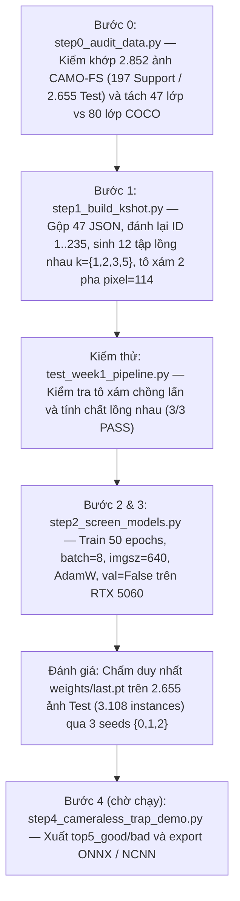
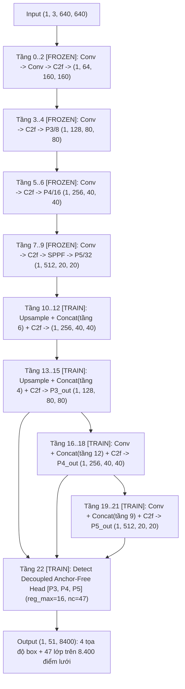

# Báo Cáo Kỹ Thuật Ngắn Gọn — Dự Án CAMO-FS Few-Shot YOLOv8s

## 1. Pipeline Thực Hiện (Bước 0 → Bước 4)



| Bước | Thành phần thực thi | Đầu ra đã ghi nhận |
| :--- | :--- | :--- |
| **Bước 0** | `code/step0_audit_data.py` | `results/DATA_CHECK.md`, `results/class_overlap.json` (8 lớp `exact`, 7 lớp `semantic_family`, 32 lớp `novel`) |
| **Bước 1** | `code/step1_build_kshot.py`, `code/test_week1_pipeline.py` | `results/camo5_support_5shot_merged.json`, 12 thư mục `runs/processed_data/k{1,2,3,5}_seed{0,1,2}`, `test/`, 13 file `.yaml` |
| **Bước 2 & 3** | `code/step2_screen_models.py` | 60 thư mục trọng số tại `runs/models/`, `results/model_stability_raw.csv`, `results/model_stability_report.md` |
| **Bước 4** | `code/step4_cameraless_trap_demo.py` | Chưa chạy trên máy hiện tại (thiếu gói `onnx`, `onnxslim`, `ncnn`; hiện mới cài `onnxruntime`) |

---

## 2. Cấu Hình Và Kết Quả Model Được Chọn (`v8s_rich_backbone` — YOLOv8s)

- **Thông số mô hình (`last.pt`, 47 lớp):** `11.153.789` tham số (`28.74 GFLOPs` trước fuse; `11.143.773` tham số / `72` layers / `28.5 GFLOPs` sau fuse), dung lượng file `last.pt` là `22.54 MB`.
- **Thiết lập huấn luyện:** Khởi tạo từ `yolov8s.pt`, `freeze=10` (đóng băng `5.079.712` tham số tầng `0..9`, huấn luyện `6.074.077` tham số tầng `10..22`), `optimizer=AdamW`, `lr0=0.0005`, `mosaic=0.0`, `close_mosaic=0`, `epochs=50`, `batch=8`, `imgsz=640`, `deterministic=True`, `val=False`. Thời gian train `k5_seed0` trên RTX 5060: `162.1 s`.

### 2.1. Kiến trúc bên trong `v8s_rich_backbone` (đầu vào `1 x 3 x 640 x 640`)



### 2.2. Kết quả đo trên tập Test (`2.655` ảnh, `3.108` instances, đánh giá `last.pt`)

| Chỉ số (Mean ± Std, 3 seeds) | 1-shot | 2-shot | 3-shot | 5-shot |
| :--- | :---: | :---: | :---: | :---: |
| **Box AP (All 47 lớp)** | 6.00 ± 0.65 | 8.50 ± 0.95 | 10.46 ± 0.61 | 13.56 ± 0.12 |
| **Box AP50 (All 47 lớp)** | 8.56 ± 1.08 | 12.36 ± 1.22 | 15.56 ± 0.75 | 19.82 ± 0.39 |
| **Box AP75 (All 47 lớp)** | 6.39 ± 0.72 | 9.22 ± 0.98 | 11.29 ± 0.60 | 14.34 ± 0.20 |
| **Non-Exact AP (39 lớp)** | 3.55 ± 0.40 | 6.26 ± 0.78 | 7.92 ± 0.78 | 10.84 ± 0.33 |
| **COCO-Overlap AP (8 lớp exact)** | 17.93 ± 2.37 | 19.40 ± 3.45 | 22.87 ± 2.81 | 26.81 ± 0.88 |
| **Độ trễ suy luận (RTX 5060)** | 4.33 ms | 4.34 ms | 4.34 ms | 4.38 ms |
| *Tham chiếu FS-CDIS (IMS, ResNet-101)* | *4.50* | *6.95* | *7.55* | *10.36* |

- **Đo tách bổ sung trên `k5_seed0` (`All=13.70`):** `Exact 8 = 26.09`, `Semantic Family 7 = 14.64`, `Strictly Novel 32 = 10.40`.

---

## 3. Lệnh Thực Thi

```bash
# Bước 0 & Bước 1 & Unit Test (đã chạy)
python code/step0_audit_data.py --data-root <CAMO_DATA_ROOT> --out-md results/DATA_CHECK.md --out-json results/class_overlap.json
python code/step1_build_kshot.py --data-root <CAMO_DATA_ROOT> --out-dir runs/processed_data --config-dir runs/configs
python code/test_week1_pipeline.py

# Bước 2 & 3 cho cấu hình v8s_rich_backbone (đã chạy)
python code/step2_screen_models.py --config-dir runs/configs --runs-dir runs/models --results-dir results --overlap-json results/class_overlap.json --variants v8s_rich_backbone --k-shots 1 2 3 5 --seeds 0 1 2

# Bước 4: Xuất ảnh phân tích và ONNX / NCNN (bước tiếp theo)
pip install onnx onnxslim ncnn
python code/step4_cameraless_trap_demo.py --weights runs/models/v8s_rich_backbone_k5_seed0/weights/last.pt --test-images runs/processed_data/test/images --out-dir results/qualitative_analysis_v8s --max-images 2655 --export-edge
```
